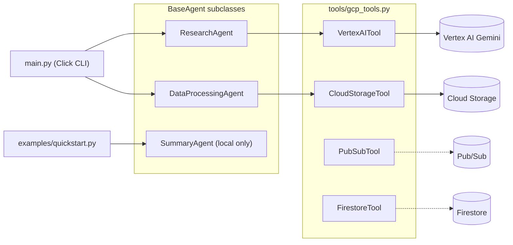

# GCP Agents: Summoner

A small Python framework for building plan, execute, reflect agents on Google Cloud. It ships a Gemini research agent and a Cloud Storage file-processing agent, both run from a Click CLI.

[](https://github.com/TirtheshJani/GCP-Agents---Summoner/actions/workflows/ci.yml)
[](LICENSE)

Summoner puts the agent lifecycle in one abstract base class, so a new agent is a subclass that defines `name`, `plan()` and `execute()`. The research agent answers questions with Gemini on Vertex AI. The data-processing agent runs a transform over files in a Cloud Storage bucket. Every GCP client sits behind a thin wrapper that the tests mock, so the 33 unit tests run without a GCP account. The local quickstart agent makes no cloud calls and needs no account either.

Status: the code runs locally and passes CI. Nothing is deployed to GCP, and the Pub/Sub and Firestore wrappers exist but no agent calls them yet.

## Highlights

- `BaseAgent` (`agents/base_agent.py`) runs `plan()`, `execute()` and `reflect()` inside a single `run()` call. It moves through a six-value `AgentState` enum, logs each step with structlog, and returns a `TaskResult` dataclass with output, error and duration. When a step raises, tenacity reruns the whole cycle, up to 3 attempts in total, with exponential backoff (bounded between 2 and 30 s).
- `ResearchAgent` makes one Gemini call that asks for 2 to 4 numbered sub-questions, then one call per numbered line in the reply. Reflection fails the task if no sub-questions were parsed or any answer is empty.
- `DataProcessingAgent` lists objects under a Cloud Storage prefix, applies a `Callable[[bytes], bytes]` transform to each one, and uploads the results under `storage.output_prefix` (default `agent-outputs/`). Its plan is a JSON document, so the file list is fixed before any write happens. The transform defaults to identity and the `process` CLI command does not pass one, so from the CLI it copies files unchanged.
- `tools/gcp_tools.py` wraps Vertex AI, Cloud Storage, Pub/Sub and Firestore. Each wrapper imports its Google library and builds the client on first use, so tests patch one method instead of the SDK.
- Configuration lives in one YAML file with `${VAR:default}` placeholders. A regex resolves them and Pydantic models validate the result (`config/__init__.py`).
- GitHub Actions runs ruff (lint and format check, pinned to 0.16.10) and pytest on Python 3.9, 3.10, 3.11 and 3.12.

## How it works

`main.py` loads `config/agent_config.yaml` (or the file passed with `--config`) into a `Settings` object and passes it to the agent for the chosen command. The agent's `run()` calls `plan()`, `execute()` and `reflect()` in order and updates its `state` at each step. The two shipped agents reach GCP through the wrappers in `tools/`. Dashed edges below are wrappers that are unit-tested but not yet called by any agent.



Reflection and retries are separate paths. If `reflect()` returns `False`, `run()` returns a `TaskResult` with `success=False` and does not retry. Retries happen only when `plan()`, `execute()` or `reflect()` raises an exception, and after the third attempt the last exception is re-raised to the caller.

## Tech stack

| Area | Libraries |
|------|-----------|
| Google Cloud | `vertexai` (Gemini; model set by `vertex_ai.model_name`, default `gemini-1.5-flash`), `google-cloud-storage`, `google-cloud-pubsub`, `google-cloud-firestore` |
| Agent runtime | structlog, tenacity |
| Config | Pydantic v2, pydantic-settings, PyYAML |
| CLI | [Click](https://click.palletsprojects.com/), [Rich](https://rich.readthedocs.io/) |
| Quality | pytest, pytest-cov, ruff, GitHub Actions |

## Getting started

You need Python 3.9 to 3.12, the versions CI tests. Newer versions are untested. The `research` and `process` commands also need a GCP project with Vertex AI and Cloud Storage access, plus credentials the Google client libraries can find (for example `gcloud auth application-default login`).

```bash
git clone https://github.com/TirtheshJani/GCP-Agents---Summoner.git
cd GCP-Agents---Summoner
python -m venv .venv
source .venv/bin/activate
pip install -r requirements.txt -r requirements-dev.txt
```

There is no `pyproject.toml`, so run commands from the repository root.

Try it without GCP:

```bash
python examples/quickstart.py   # runs a local SummaryAgent through plan, execute, reflect
python main.py config           # prints the resolved configuration as a table
```

Run the GCP agents:

```bash
export GCP_PROJECT_ID="your-project-id"
export GCP_REGION="us-central1"          # optional, this is the default
export GCP_STORAGE_BUCKET="your-bucket"  # required by `process`

python main.py research "What are the latest trends in LLM agents?"
python main.py process --prefix raw-data/
python main.py --config path/to/other.yaml config
```

## Write an agent

Subclass `BaseAgent` and implement the three required members:

```python
from agents.base_agent import BaseAgent


class GreeterAgent(BaseAgent):
    @property
    def name(self) -> str:
        return "greeter"

    def plan(self, task: str) -> str:
        return f"Greet the user about: {task}"

    def execute(self, plan: str) -> str:
        return f"Hello! {plan}"


result = GreeterAgent().run("welcome message")
print(result.output)  # Hello! Greet the user about: welcome message
```

Override `reflect(task, result)` to reject bad output. [CONTRIBUTING.md](CONTRIBUTING.md) lists the steps for adding an agent to the package and the CLI.

## Tests

| Test file | Tests | Covers |
|-----------|-------|--------|
| `tests/test_base_agent.py` | 13 | `run()` success, exception and rejection paths, `TaskResult`, `MemoryStore` |
| `tests/test_config.py` | 11 | `${VAR:default}` resolution, `Settings` defaults, YAML loading |
| `tests/test_gcp_tools.py` | 9 | All four GCP wrappers against mocked clients |

Run the same checks CI runs:

```bash
pytest tests/ -v
ruff check .
ruff format --check .
```

Coverage is not collected in CI, but `pytest-cov` is in the dev requirements:

```bash
pytest tests/ --cov=agents --cov=tools --cov=config
```

## Repository layout

```text
agents/
  base_agent.py                  BaseAgent, AgentState, TaskResult, MemoryStore
  specialized_agents/
    research_agent.py            Vertex AI research agent
    data_processing_agent.py     Cloud Storage transform agent
tools/gcp_tools.py               Vertex AI, Cloud Storage, Pub/Sub, Firestore wrappers
config/
  __init__.py                    Pydantic settings and ${VAR:default} loader
  agent_config.yaml              Default configuration
examples/quickstart.py           Local agent, no GCP needed
tests/                           pytest suite (mocked clients)
main.py                          Click CLI: research, process, config
requirements.txt                 Runtime dependencies
requirements-dev.txt             Test and lint dependencies
.github/workflows/ci.yml         Lint and test matrix
```

## Status and roadmap

The framework runs in a single process. The repo has no Dockerfile, Cloud Run or infrastructure config, and no recorded runs against a live GCP project.

Known gaps in the current code:

- Agent memory is an in-process dict (`MemoryStore`). `FirestoreTool` is not yet used as a memory backend, so state does not survive between runs.
- Some config keys are parsed but not read: `agent.max_retries`, `agent.timeout_seconds`, `agent.memory_backend` (set to `firestore` in the default YAML, but ignored), `agent.log_level`, `gcp.credentials_path`, the `pubsub` topics and the whole `logging` section. The retry count is fixed at 3 in the decorator.
- `google-cloud-logging`, `google-cloud-secret-manager` and `python-dotenv` are in `requirements.txt` but not imported.
- `DataProcessingAgent` names each output by its file basename, so `a/x.csv` and `b/x.csv` would write to the same object.
- `ResearchAgent`, `DataProcessingAgent` and the CLI have no tests yet.

Planned:

- Multi-agent orchestration and task routing (the `agent-tasks` and `agent-results` Pub/Sub topics are already in config)
- Firestore-backed memory store
- Cloud Run deployment with a Dockerfile
- Streaming agent responses
- An agent observability dashboard

## Author

Tirthesh Jani. [GitHub](https://github.com/TirtheshJani) · [LinkedIn](https://www.linkedin.com/in/tirthesh-jani)

## License

MIT. See [LICENSE](LICENSE).
